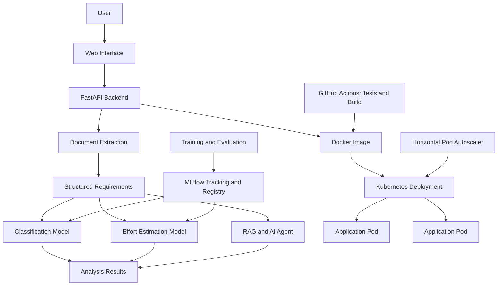
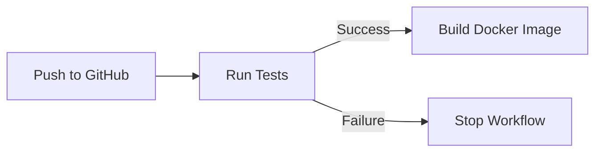

# MLOps Platform | Intelligent Project Requirements Analysis

**An end-to-end MLOps platform that transforms client requirement documents into structured project insights, classifies software projects, estimates development effort, and integrates machine learning with automated deployment and Kubernetes orchestration.**

<p align="center">       </p>

## Overview

Software development projects often begin with unstructured client requirements distributed across documents. Extracting the relevant information, identifying the appropriate technical domain, and estimating the required development effort can be time-consuming.

**MLOps Platform** addresses this challenge through an integrated application combining document processing, machine learning, retrieval-augmented generation (RAG), and DevOps practices.

Users can submit requirement documents, extract structured information, classify projects into technical categories, estimate development effort, and interact with an AI-powered assistant to explore project requirements.

Beyond model development, the project focuses on operationalising machine learning through experiment tracking, containerisation, Kubernetes deployment, automated testing, and infrastructure monitoring capabilities.

### Key objectives

- Automate the extraction of useful information from client requirement documents.
- Apply machine learning to software project classification and effort estimation.
- Make project information accessible through an AI-powered interface.
- Track and manage machine learning experiments.
- Deploy the application in containers and orchestrate it using Kubernetes.
- Establish a reproducible workflow for testing, building, and deploying the application.

## Features

### 1. Intelligent Document Processing

Extract structured information from client requirement documents in supported formats:

- PDF
- DOCX
- TXT

The extraction pipeline identifies relevant project information, such as:

- Project domain and objectives
- Technologies and frameworks
- Database requirements
- External integrations
- Security requirements
- Deadlines and constraints
- Other relevant functional and technical requirements

The extracted information can serve as input for subsequent analysis and project estimation.

### 2. Machine Learning Classification

A supervised machine learning model classifies software projects into five technical categories:

| Category           | Description                                              |
| ------------------ | -------------------------------------------------------- |
| Web Application    | Web-based platforms and applications                     |
| Mobile Application | Applications designed for mobile devices                 |
| AI/ML              | Artificial intelligence and machine learning solutions   |
| Data/BI            | Data engineering, analytics, and business intelligence   |
| Cloud/DevOps       | Cloud infrastructure, automation, and deployment systems |

The classification pipeline uses project-related information to predict the most relevant category.

**Reported classifier accuracy: approximately 81%.**

This is the project's observed result, not a guarantee of performance on every new dataset. Evaluation results depend on the dataset, validation methodology, and distribution of future inputs.

### 3. Development Effort Estimation

A regression model estimates the development effort associated with a software project.

The objective is to provide an initial quantitative estimate that can support project planning and requirement analysis.

**Reported model R²: approximately 0.72.**

This indicates that the model explains approximately 72% of the variance in the evaluated target under the evaluation setup used. It does not mean that individual predictions are 72% accurate.

Predictions should be interpreted as estimates rather than guaranteed delivery commitments.

### 4. AI-Powered Requirement Analysis

The platform integrates retrieval-augmented generation (RAG) and an AI agent to support interactions with project requirement information.

This enables users to explore extracted information and ask questions about the project rather than manually searching through the original documents.

The AI integration uses a configurable language-model provider, including Groq-hosted models.

The architecture combines structured extraction, machine learning predictions, and language-model capabilities to support a more complete requirements-analysis workflow.

### 5. MLflow Experiment Tracking

The machine learning workflow integrates MLflow to track experiments and manage model versions.

The project includes:

- Model training workflows
- Experiment tracking
- Model evaluation
- Model registry integration

This establishes a foundation for reproducible experimentation and model lifecycle management.

### 6. Containerisation

The application is packaged using Docker.

The Docker build includes the Python environment, application code, ML components, required dependencies, and model preparation steps.

Containerisation provides a consistent execution environment and simplifies deployment across supported environments.

### 7. Kubernetes Deployment and Autoscaling

The application is deployed on Kubernetes with a Deployment, Service, health probes, and Horizontal Pod Autoscaler (HPA).

The current configuration includes:

- **2 minimum replicas**
- **5 maximum replicas**
- **70% target CPU utilisation**
- CPU and memory resource requests and limits
- Liveness and readiness probes using `/health`

The HPA uses CPU utilisation metrics to determine whether additional replicas are needed.

The deployment has been verified with two running application pods. Autoscaling behaviour should be evaluated separately under load.

### 8. Continuous Integration

GitHub Actions automates the project's CI workflow.

The current workflow includes:

1. Checking out the repository.
2. Setting up Python.
3. Installing test dependencies.
4. Running the extraction and feature tests.
5. Building the Docker image after successful tests.

Successful workflow runs provide evidence that the configured tests and Docker build complete in the CI environment.

Automatic publication to GitHub Container Registry (GHCR) is a separate pipeline capability and should be considered complete only after the image push has been implemented and verified.

---

## Architecture

The platform combines an application layer, machine learning components, and deployment infrastructure.



The diagram describes the main application and deployment components. The exact model-loading, registry, and image-publication mechanisms depend on the configured deployment workflow.

## Technology Stack

| Area                   | Technologies                                       |
| ---------------------- | -------------------------------------------------- |
| Programming language   | Python                                             |
| API and backend        | FastAPI, Uvicorn                                   |
| Machine learning       | Classification, regression, scikit-learn ecosystem |
| Document processing    | PDF, DOCX, and TXT extraction                      |
| AI and language models | RAG, AI agent, Sentence Transformers, Groq         |
| Experiment tracking    | MLflow                                             |
| Frontend               | HTML, CSS, JavaScript                              |
| Containerisation       | Docker                                             |
| Orchestration          | Kubernetes                                         |
| Autoscaling            | Kubernetes HPA, Metrics Server                     |
| Continuous integration | GitHub Actions                                     |
| Version control        | Git, GitHub                                        |

## Project Structure

The main project components are organised as follows:

```text
mlops-platform/
├── app/
│   └── main.py                 # FastAPI application and API endpoints
├── ml/
│   ├── generate_dataset.py     # Synthetic dataset generation
│   ├── train_classifier.py    # Classification model training
│   └── train_regressor.py     # Regression model training
├── static/                     # Web interface assets
├── tests/
│   ├── test_extraction.py      # Document extraction tests
│   └── test_features.py        # Feature processing tests
├── .github/
│   └── workflows/
│       └── ci.yml              # Automated tests and Docker build
├── Dockerfile                  # Container image definition
├── requirements.txt            # Python dependencies
└── README.md
```

*This is a representative overview of the main components. Additional files and directories may exist in the repository.*

## Getting Started

### Prerequisites

Install or configure:

- Python 3.13
- Git
- Docker Desktop
- Kubernetes tooling, if you want to reproduce the deployment
- A Groq API key if you want to use features that depend on the external language-model service

### 1. Clone the repository

```bash
git clone https://github.com/zaineb-mahjoub/mlops-platform.git
cd mlops-platform
```

### 2. Create a virtual environment

**Windows PowerShell:**

```powershell
python -m venv venv
.\venv\Scripts\Activate.ps1
```

Install the project dependencies:

```powershell
python -m pip install --upgrade pip
pip install -r requirements.txt
```

### 3. Configure environment variables

Configure the environment variables required by your application, including the Groq API key if applicable.

Do not commit API keys, credentials, or production secrets to Git.

For local development, use a local environment file that is excluded by `.gitignore`, or configure the variables directly in your shell.

### 4. Start the application

```powershell
uvicorn app.main:app --reload --host 127.0.0.1 --port 8000
```

Open the following local endpoints:

- Application health: `http://127.0.0.1:8000/health`
- Interactive API documentation: `http://127.0.0.1:8000/docs`

The interactive documentation allows you to inspect the available endpoints and test supported requests.

### 5. Run the tests

The current CI workflow runs:

```powershell
pytest tests/test_extraction.py tests/test_features.py -v
```

Install the test dependencies first if they are not already included in your environment.

## Docker Deployment

### Build the image

Start Docker Desktop and ensure that its Linux engine is running.

From the project root:

```powershell
docker build -t mlops-platform:latest .
```

### Run the container

```powershell
docker run --rm -p 8000:8000 mlops-platform:latest
```

If your selected application endpoints require external API credentials, configure them through an appropriate environment-variable mechanism when starting the container. Do not embed secrets in the Docker image.

Verify the deployment:

```powershell
curl.exe http://localhost:8000/health
```

Open the API documentation at `http://localhost:8000/docs`.

**Note:** The Dockerfile prepares the sentence-transformer model and trains the project's models during the image build. These operations can increase build time and image size. A future improvement would be to separate model training from application image construction and use versioned model artifacts.

## Kubernetes Deployment

The application has been deployed to a Kubernetes cluster.

### Verify the deployment

```bash
kubectl get nodes
kubectl get deployment mlops-platform
kubectl get pods
kubectl get svc
```

### Verify autoscaling

```bash
kubectl get hpa
kubectl describe hpa mlops-platform-hpa
kubectl top pods
```

The configured HPA uses CPU utilisation to manage replicas between two and five, targeting 70% CPU utilisation relative to the configured CPU requests.

To demonstrate actual autoscaling, generate a controlled workload and verify that the replica count changes. The presence of an HPA alone does not prove that a scale-up event has occurred.

## API Overview

The platform exposes functionality through its FastAPI backend.

| Endpoint          | Purpose                               |
| ----------------- | ------------------------------------- |
| `GET /health`     | Application health check              |
| `GET /docs`       | Interactive API documentation         |
| `/classify`       | Software project classification       |
| `/predict-effort` | Development effort estimation         |
| `/analyze`        | AI-powered analysis, where configured |

Consult `/docs` for the exact HTTP methods, input schemas, output formats, and other available endpoints.

## CI Workflow

The current GitHub Actions workflow executes the configured tests before building the Docker image.



A successful run verifies the configured CI checks.

For a complete automated container-delivery pipeline, the next step is to publish versioned images to GitHub Container Registry (GHCR) and configure Kubernetes to deploy those images.

## Model Evaluation

The project currently reports the following model evaluation results:

| Component          | Metric   |    Reported result |
| ------------------ | -------- | -----------------: |
| Project classifier | Accuracy |  Approximately 81% |
| Effort estimator   | R²       | Approximately 0.72 |

These results are specific to the evaluation performed during development.

The training workflow uses synthetic project data. Consequently, these figures should not be interpreted as proof of equivalent performance on real client projects.

A production-oriented evaluation would additionally examine class-wise precision and recall, a confusion matrix, regression error metrics such as MAE and RMSE, and performance on representative held-out data.

## Current Status and Roadmap

The platform already combines application development, machine learning, containerisation, and Kubernetes orchestration.

The following items distinguish implemented capabilities from potential extensions:

| Capability                                          | Status                     |
| --------------------------------------------------- | -------------------------- |
| FastAPI backend and health endpoint                 | Implemented                |
| Document extraction                                 | Implemented                |
| Project classification                              | Implemented                |
| Development effort estimation                       | Implemented                |
| RAG and AI-agent integration                        | Implemented                |
| MLflow experiment tracking and registry integration | Implemented                |
| Docker image build                                  | Implemented                |
| GitHub Actions tests and Docker build               | Verified in CI             |
| Kubernetes Deployment and Service                   | Deployed                   |
| Two application replicas                            | Verified                   |
| Metrics Server and CPU-based HPA                    | Configured and operational |
| Actual HPA scale-up under load                      | Planned                    |
| Automatic GHCR publication                          | Planned                    |
| ArgoCD-based GitOps                                 | Planned                    |
| Prometheus and Grafana monitoring                   | Planned                    |
| Data-drift detection and visualisation              | Planned                    |

### Potential next steps

- Automate versioned Docker image publication to GHCR.
- Introduce ArgoCD to reconcile Kubernetes resources from Git.
- Integrate Prometheus and Grafana for infrastructure and application monitoring.
- Implement a data-drift detector comparing production inputs against a reference dataset.
- Export drift metrics to Prometheus and visualise them in Grafana.
- Add automated model evaluation and retraining workflows.
- Expand the test suite and evaluate models on representative real-world data.

## Engineering Considerations

Several design choices offer opportunities for further improvement:

- **Synthetic training data:** Useful for developing the pipeline, but real-world validation is needed before relying on the model for client-facing estimates.
- **Model lifecycle:** Separating training from container builds would improve reproducibility and deployment efficiency.
- **Model evaluation:** Tracking model versions alongside evaluation results would make performance comparisons more systematic.
- **Scalability:** Kubernetes HPA provides replica scaling based on resource utilisation; it does not by itself guarantee application-level throughput or high availability.
- **Monitoring:** Infrastructure metrics and model-quality monitoring are different concerns and should be evaluated separately.
- **Security:** API credentials and sensitive client requirements must be handled through appropriate secret-management and access-control mechanisms.

## What This Project Demonstrates

This project brings together several areas of software engineering and applied machine learning:

- Building and exposing ML functionality through REST APIs.
- Processing unstructured documents into structured information.
- Integrating machine learning with retrieval and language-model workflows.
- Tracking experiments and managing model versions with MLflow.
- Packaging an application and its dependencies with Docker.
- Deploying and scaling services using Kubernetes.
- Automating testing and image builds with GitHub Actions.
- Designing a path toward GitOps, observability, and data-quality monitoring.

The objective is not simply to train a model, but to develop the surrounding infrastructure required to integrate machine learning into a deployable software application.

## Author

**Zaineb Mahjoub**

Computer Science Student | Machine Learning | MLOps | Backend Development | DevOps

[GitHub Profile](https://github.com/zaineb-mahjoub)

---

*Developed as an MLOps engineering project focused on intelligent software requirements analysis, machine learning integration, and automated deployment.*
